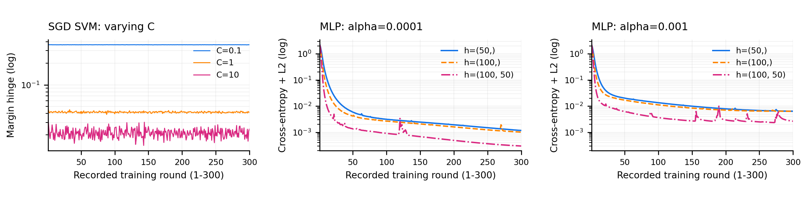
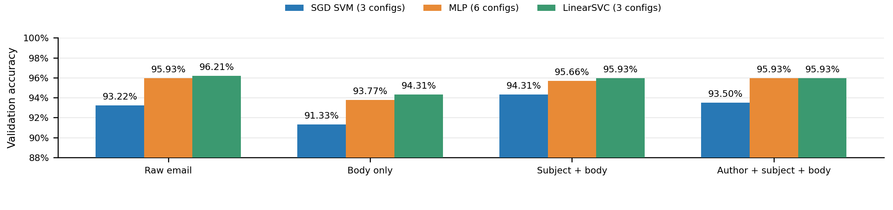
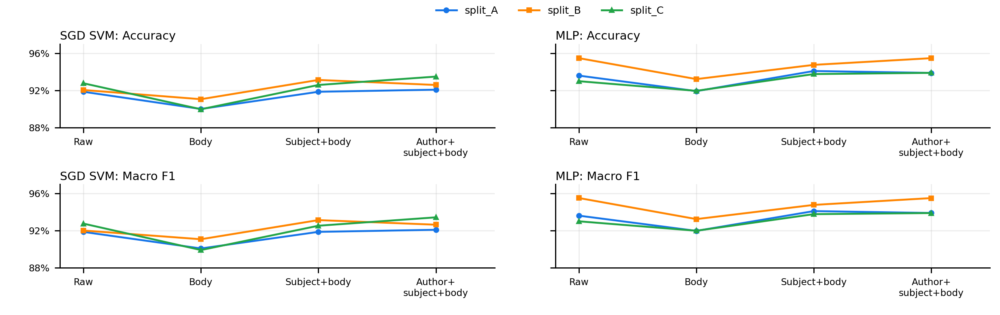

# 实验一：文本分类
（仓库：https://github.com/Robert4063/ContemporaryAI-26-fall lab_1分支）

在这次任务中，我们要用给定的标注数据训练模型，再对无标签文本输出0-9中的一个类别。训练时，损失来自预测与真实标签的差异，再由优化算法更新参数；无标签数据用于最后预测。。

## 1. 数据划分
在进行试验之前，我们会遇到第一个问题：训练集应该如何划分？  
由于没有单独的验证集，所以将train_data.csv重新划分为训练、验证和本地测试集是一个很自然的想法。传统的划分方式是80：10：10，但是数据的划分方式是不是也会影响最终的结果呢？为了探究这个问题，我取80:10:10作为基线，再比较85:5:10和90:5:5。7368条标注文本的10类各有705-747条，长度中位数1139字符，无缺失和整段完全重复原文；划分采用分层抽样，固定种子42，另有2457条无标签文本留待预测。

| 划分 | 训练:验证:测试 | 训练数 | 验证数 | 测试数 |
| --- | --- | --- | --- | --- |
| A | 80:10:10 | 5894 | 737 | 737 |
| B | 85:5:10 | 6262 | 369 | 737 |
| C | 90:5:5 | 6630 | 369 | 369 |

## 2. 数据清洗
只要看了数据本身的形式，我们就会很自然地问出第二个问题：哪些文本信息值得保留？  
原来的数据是以邮件的形式表现的，文本带有Subject、From（标题和作者）。这些可能提供线索，与这些数据相比，其他的数据更像是一种噪声，虽说不能说毫无用处，但是在直觉上会觉得会有干扰。为了探究这个想法，我设计了比较raw原文、body_only正文、subject_body标题+正文、subject_body_author作者+标题+正文这四种方式，看看那种办法会更好。

向量统一用TF-IDF表示，IDF降低常见词权重，L2归一化减轻长度造成的尺度差异。设置min_df=2、max_df=0.95、max_features=20000；词表和IDF仅在训练集拟合，其余只做transform。

## 3. 参数设置
准备好数据之后，我们来选择模型。在给定的方法中，我选择了SGD SVM和MLP，又在B划分补充LinearSVC。SGD SVM的目的是得到SVM的loss函数，并将此与LinearSVC进行对比；MLP通过隐藏层和ReLU学习非线性关系，并使用同一套TF-IDF输入。

| 模型 | 候选参数与实际训练设置 |
| --- | --- |
| SGD SVM | C∈{0.1,1,10}；hinge、L2；α=1/(C×训练数)；300次warm_start单轮fit |
| MLP | h∈{(50,),(100,),(100,50)}，α∈{0.0001,0.001}；Adam、学习率0.001；300轮，不早停 |
| LinearSVC | 仅B；C∈{0.1,1,10}；squared_hinge、L2、OvR、dual=auto；tol=0.0001，最多10000次迭代 |

三种划分×四版本×九配置共108组，补充LinearSVC 12组后共120组。我们使用验证Accuracy的数值来选取模型，如果并列看宏F1，再按配置名固定并列顺序；test不参与排序。补充模型均收敛，实际迭代12-327次。

## 4. 实验结果
可以看到，loss函数曲线如下：

图1　将SGD SVM与MLP隐藏层loss合并：固定B、作者+标题+正文。
左图为3个C，中/右分别固定α=0.0001/0.001比较h=(50,)、(100,)、(100,50)。均为300轮原始记录，无平滑

loss 曲线大致分为两类：SGD SVM 是平台型，C=0.1 时损失较高且几乎不变，C=1 时较低且稳定，C=10 时更低但波动明显；与此相比，MLP 先快速下降、再逐渐放缓。同一 α 下，单层100个神经元的 loss 略低于50个，两层(100,50)更快、更低，但有局部尖峰，尤其是 α=0.001 时。相比之下，α=0.0001 后期仍持续下降，α=0.001 更接近平台。

<!-- pagebreak -->

图2　B划分各模型/文本版本的最佳验证Accuracy；每版本SGD、MLP、LinearSVC分别搜索3、6、3组。

按val锁定的配置分别为SGD：标题+正文、C=1；MLP：作者+标题+正文、h=(100,)、α=0.001；LinearSVC：raw、C=1。对应结果为：

| 模型 | 验证Acc | 测试Acc | 测试P | 测试R | 测试F1 |
| --- | --- | --- | --- | --- | --- |
| SGD SVM | 94.31% | 92.94% | 93.07% | 92.97% | 92.99% |
| MLP | 95.93% | 93.22% | 93.39% | 93.22% | 93.28% |
| LinearSVC | 96.21% | 93.08% | 93.31% | 93.09% | 93.16% |

整体来看，LinearSVC与MLP较为接近，均高于当前的SGD SVM基线：LinearSVC在原文、正文和标题＋正文上略高于MLP，加入作者后两者同为95.93%，原文下LinearSVC最高，为96.21%。只保留正文时三种方法都明显下降，补回标题后均有所恢复；继续加入作者后，SGD SVM略降、MLP略升、LinearSVC不变。这说明邮件头包含分类线索，但是作者信息的作用与模型有关。
但是很奇怪，MLP的表达能力更强，为什么这里却比不过LinearSVC呢？继续分析会发现，TF-IDF得到的是高维稀疏向量，许多类别线索通过词语的线性加权就能提取，因此线性SVM已有较好效果。相比来说，MLP需要估计更多参数，样本有限时更容易拟合偶然模式，也受结构、初始化和优化设置影响。更强的表达能力并不保证更好的泛化，我们还是需要根据具体情况选择模型。
## 5. 数据划分分析
那么我们的不同的划分起了什么作用呢？

图3　列为模型，行为Accuracy/宏F1，颜色为A/B/C；每点是超参数均值（SGD 3组、MLP 6组）

其实还挺明显的。在85：5：10的划分下，几乎所有清洗方式的准确度都提高了，我们会发现划分也会影响结果。但是怎么样找到最优的划分方式呢？这点还是一个很难探究的问题。

## 6. 模型思考与扩展
在学习了MLP之后会发现，增加神经元、层数或训练轮数有可能提升性能，但是也有过拟合的风险。这次固定α=0.001，隐藏层从(50,)增至(100,)，验证准确率由95.66%升至95.93%；继续加深为(100,50)，虽然训练loss更低，验证准确率却降至94.31%，说明更复杂的网络并不必然带来更好的泛化。

## 7. 无标签预测

最后，我们按照验证集准确度选取LinearSVC（B、raw、C=1），预测test_data_unlabeled.csv，生成2457行、无表头的prediction.csv，标签0-9、顺序不变。

环境：Python 3.10.21，scikit-learn 1.7.1，种子42；原始loss、配置、评价与预测哈希均保留。
